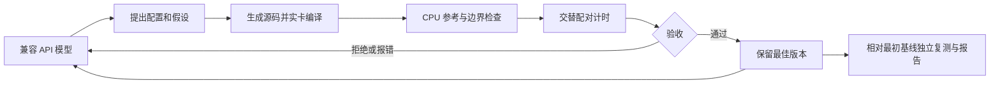

# Ascend 算子优化 Agent

Evidence-driven operator tuning on Huawei Ascend NPUs with Triton-Ascend and LLM tool calling.

[验证记录](VALIDATION.md) · [Notebook](RUN_AGENT.ipynb) · [相关 vLLM-Ascend PR](https://github.com/vllm-project/vllm-ascend/pull/18765)

- **实现**：四类预置算子的候选生成、实卡编译、正确性检查、配对测速、profiler 与验收闭环。
- **910B4 实测**：Vector Add 相对初始 Triton 配置 1.23×；融合 RMSNorm 相对 PyTorch eager 分解表达式 2.04×。两项为算子微基准。
- **真实模型接入**：DeepSeek 驱动 GDN 调优 50 轮；未建立稳定提速，保留原始配置。
- **工程验证**：24 项 Agent 测试；CANN 8.5 batch commit 兼容修复通过 67 项相关测试。NPU 记录来自已封存实验，详见验证报告。

面向华为 Ascend NPU 的 Triton-Ascend 算子自动调优工具，支持 **vector add**、**RMSNorm**，以及投机解码项目的 **GDN verify / commit**。模型通过工具调用提出配置，固定模板生成候选源码，真实 NPU 执行器负责编译、正确性、性能分析和验收。

**当前边界：支持四种预置算子的受约束变换，不接受任意算子源码。** RMSNorm 可从 PyTorch eager 分解表达式切换到融合 Triton kernel；vector add 搜索 tile 与展开次数。Ascend C 后端尚未实现。

模型接口支持 OpenAI 兼容的 **Chat Completions**，以及 **Responses**。无需安装模型 SDK。编排器只用 Python 标准库；NPU 工作进程使用镜像已有的 PyTorch、torch_npu、Triton-Ascend，不会自动升级驱动或工具链。

## 快速运行

已提供可离线安装的 wheel（NPU 运行库使用当前镜像已有版本）：

```bash
python3 -m pip install --no-index --no-deps dist/ascend_optimizer_agent-0.2.0-py3-none-any.whl
ascend-opt --version
```


JupyterLab 可直接打开 [RUN_AGENT.ipynb](RUN_AGENT.ipynb)，按单元格运行和隐藏输入 API key。实卡结果与验证范围见 [VALIDATION.md](VALIDATION.md)。

在有 NPU 的 Linux 环境进入本目录。Mac 可以运行协议/状态测试、初始化任务与生成报告；NPU 实验需要在远端运行。当前 AtomGit Notebook 可直接使用 JupyterLab Terminal，不依赖 CANNLab CLI，也尚无 SSH 直连适配器。

```bash
python3 -m ascend_optimizer doctor
python3 -m ascend_optimizer init --task vector_add --workspace runs/add
python3 -m ascend_optimizer search --workspace runs/add --max-candidates 6 --profile
```

这条 `search` 使用内置参数搜索，不调用大模型，适合先检查整套工具是否真正可用。输出 `runs/add/REPORT.md`、`best.py`、原始计时、完整决策轨迹，以及可选的 CPU/NPU profiler trace。

```bash
python3 -m ascend_optimizer init --task rms_norm --workspace runs/rms
python3 -m ascend_optimizer search --workspace runs/rms --max-candidates 4 --profile
```

手动提出一项假设，也可使用同一验收流程：

```bash
python3 -m ascend_optimizer evaluate --workspace runs/add \
  --config '{"block":4096,"unroll":4}' --reason '增大每次发射处理的数据量'
```

## 接入你选择的 OpenAI 兼容 API

密钥可从环境变量或当前用户拥有、权限为 0600 的私有文件读取，不写进 task、源码、报告或工作进程环境。模型必须支持函数工具调用。

```bash
export ASCEND_OPT_BASE_URL='https://你的服务地址/v1'
export ASCEND_OPT_MODEL='你实际可用的模型名'
export ASCEND_OPT_API_MODE='chat'
# OPENAI_API_KEY 由你自己的终端环境或密钥管理器提供。

python3 -m ascend_optimizer init --task rms_norm --workspace runs/rms-llm
python3 -m ascend_optimizer agent --workspace runs/rms-llm \
  --max-steps 24 --max-tools 64 --profile
```

也可用 `--base-url`、`--model`、`--api-mode`、`--key-env`、`--key-file` 覆盖配置。base URL 填服务提供商指定的根路径，程序追加 `/chat/completions` 或 `/responses`；DeepSeek 官方地址为 `https://api.deepseek.com`。远端 API 使用 HTTPS；本机回环 HTTP 服务可用于开发。程序不跟随 API 重定向，避免把 Authorization 转发到其他地址。

如果服务只提供 Responses，设置：

```bash
export ASCEND_OPT_API_MODE='responses'
```

这两种 API 的协议、工具结果关联与多轮流转都有本地 HTTP 集成测试。**项目交付时是否调用过真实模型服务，见 [VALIDATION.md](VALIDATION.md)；协议测试使用确定性服务替身，不能当成真实模型效果。**

## 投机解码项目的 GDN 调优

`project_sources/origin.json` 锁定公开项目提交和源码 SHA256。适配器保留原内核的 FP32 运算顺序与 `enable_fp_fusion=False`，支持 value tile 和短窗口（<=4）的静态循环展开。宽 key 维度继续使用原 tile=32，长窗口保留原循环。

```bash
python3 -m ascend_optimizer init --task gdn_verify --workspace runs/gdn-verify
python3 -m ascend_optimizer agent --workspace runs/gdn-verify \
  --base-url https://api.deepseek.com --model deepseek-v4-flash \
  --key-file ~/.config/ascend-optimizer/api-key \
  --request-options '{"max_tokens":4096,"thinking":{"type":"disabled"}}' \
  --max-steps 40 --max-tools 96 --timeout 900 --profile
```

同样可用 `--task gdn_commit`。模型别名以服务端实际响应为准；每轮保存返回的模型名称与 token usage。模型只能调用允许的工具，不能改评测器或执行 shell。

GDN 验证包含独立 CPU 递推参考、与原始 NPU 内核的逐位比对、整块 backing storage 的越界与输入不可变检查、多 seed、FP32/BF16、int32/int64 元数据、空/负 slot、重排 ID、零长度及截断前缀。基准覆盖 batch=1/8/32、48 value heads / 16 QK heads、128x128 state、window=4。

`python3 run_project_regression.py` 运行冻结的原项目基线算子和上下文生命周期测试，需要 pytest。该基线在 CANN 8.5 上有 5 项融合 batch commit 编译失败；已经过 67 项相关测试验证的修复版本可这样重现：

```bash
python3 run_project_regression.py \
  examples/verified-gdn-910b4/gdn_recover.py \
  examples/verified-gdn-910b4/gdn_recover_batch.py
```

它只提供 vLLM import 命名空间与 Triton import shim，没有安装完整模型引擎，不能代替整模型验收。单层 commit 的结论也不能直接外推到融合的 batch commit。

Notebook 一次只有 2 小时，实例停止后临时盘会丢失。运行 `python3 export_project_evidence.py` 将检查点导出到父目录，再通过文件浏览器下载；源码与密钥需分别恢复。

## 工具与完成条件



| 工具 | 作用 |
|---|---|
| `get_task` / `get_environment` | 读取固定任务与真实设备、工具链信息 |
| `read_candidate` / `propose_candidate` | 阅读源码，用受支持配置生成新候选并保存假设 |
| `compile_kernel` | 在 NPU 触发真实编译和启动 |
| `validate_kernel` | 检查 CPU 参考、两组随机输入、输入不可变、输出 guard、NaN |
| `bench_kernel` | 再检查正确性，交替测量候选和当前最佳版本 |
| `profile_kernel` | 记录 CPU/NPU trace 与事件摘要；与无 profiler 的验收计时分开 |
| `accept_candidate` | 依据新鲜、匹配源码和当前最佳版本的证据决定是否晋升 |
| `get_history` | 读取失败、计时和裁决，支持下一轮反思 |

模型只写最终文本不能算完成。通用任务至少需要一项真实候选裁决；GDN 任务要求三项。每个已计时的候选都必须先裁决，之后才能编译、验证或计时其他候选。步数耗尽、API 错误、提前结束会有独立状态和非零 CLI 退出码，已有最佳版本仍保留。最后报告由程序从证据生成，模型文字不替代实测。

## 可信计时的范围

- 固定 shape、dtype、epsilon、随机种子；编译和热身不计入时间。
- 使用 `torch.npu.Event`；交替 ABBA/BAAB，默认 7 个配对轮次，每个计时段 20 次调用。
- 设备 event 覆盖连续 host 发射，可能含设备等待 host 的空隙；run 内分配计入计时，输入/输出预分配不计入。
- 以每项配对加速比中位数的等权几何均值汇总；探索性 bootstrap 区间下界至少 1.02，且每项中位加速比不低于 0.98，才晋升。
- 这些区间只用于小样本搜索，不能当作严格性能认证。复用输入可能命中缓存，不能由逻辑字节数直接推断 HBM 吞吐。
- RMSNorm 基线是 PyTorch eager 分解表达式；相对它的加速不代表超过厂商最优融合算子。
- 最佳版本会与**最初基线重新配对测量**。不能把每次晋升比例相乘当成最终收益。
- GDN 使用 9 个配对轮次，每个计时段 5 次调用，4 次热身。commit 每个计时段之前恢复相同状态，恢复操作不计入时间。
- 性能测试应串行使用这张 NPU；其他进程的负载会影响结果。

## 恢复与产物

重新运行同一 `search` / `agent` 命令会保留已有最佳版本。`search` 会跳过已经完成裁决的配置；`agent` 会读取之前的轨迹，开始新的对话。旧的编译/计时状态不会跨会话直接授权晋升。尚未裁决的候选可以重新提出和测量。

`init` 不覆盖已有任务。任务合同和候选源码有 SHA256 校验。需要不同 shape/dtype/阈值时，先用 `--task-file` 创建新工作区；修改现有 `task.json` 会被拒绝。

```text
runs/<任务>/
  task.json                 固定规格
  environment.json          实际硬件与工具链
  candidates/<id>.py/json    每份源码、配置与假设
  baseline.py / best.py      原始基线 / 当前最佳
  evaluations/*.json        原始配对计时、正确性结果和统计
  trajectory.jsonl          工具调用、错误与接受/拒绝轨迹
  profiles/.../trace.json    可选的真实 CPU/NPU trace
  conversation-*.jsonl       模型调用轨迹（不含 API 请求头）
  result.json / REPORT.md    最终独立复测与报告
```

```bash
python3 -m ascend_optimizer report --workspace runs/add
python3 -m unittest discover -s tests -v
# 以下命令实际占用 NPU，运行两类调优、profile 以及一个错误 kernel 的拒绝测试：
python3 -u validate_npu.py
```

长任务的 worker 超时默认 240 秒，可用 `--timeout 600` 调整。超时会终止 worker 进程组；工作区有互斥锁，避免两个优化进程同时修改同一最佳版本。生成模板属于本项目的可信代码，worker 超时和密钥剥离不是通用恶意代码沙箱。

AtomGit Notebook 页面有会话时限。源码与结果应取回本机；当前项目的原始副本保存在 Mac 工作区。不要依赖 Notebook 的临时磁盘永久保存结果。[平台使用限制](https://docs.gitcode.com/docs/help/home/ai-community/ai-notebook/)

## 结构与扩展

- `tasks.py`：规格、参数边界、模板。新增算子也需要补充独立 CPU 参考和验证用例。
- `worker.py`：真实 NPU 编译、正确性、配对测速、profiler。
- `engine.py`：不可变候选、工具状态、候选晋升、证据与报告。
- `llm.py` / `agent.py`：兼容 API 与工具反馈循环。
- `runtime.py`：持续运行且可终止的 worker，移除模型密钥等环境变量。
- `tests/`：接受规则、失效证据、恢复、真实 HTTP 协议测试。

技术文档：[Triton-Ascend](https://github.com/triton-lang/triton-ascend)、[OpenAI Function calling](https://developers.openai.com/api/docs/guides/function-calling)。

## 开源与证据

本仓库按 Apache-2.0 发布，见 [LICENSE](LICENSE)。冻结的上游 GDN 源码、派生候选及回归测试的来源与许可见 [NOTICE.md](NOTICE.md) 和 `origin.json`。

`VERIFIED_DELIVERY_MANIFEST.json` 保存发布前实卡验证交付版本的原始文件哈希；本仓库增加了 GitHub 展示说明、许可证和发布配置，原始证据保持不变。

在无 NPU 环境可运行编排器测试与离线证据复核：

```bash
python3 -m unittest discover -s tests -v
python3 verify_artifacts.py
python3 verify_project_evidence.py
```

NPU 编译、性能和项目回归需要验证报告中的 Ascend 环境。
